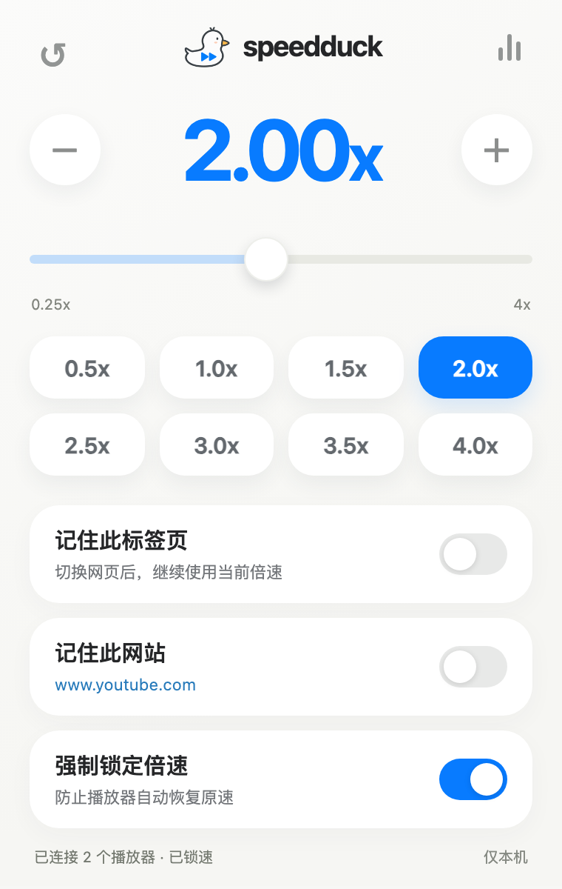
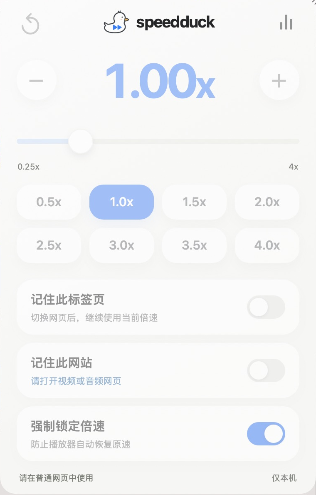

<div align="center">


# speedduck

**让网页里的播放速度，听你的。**

一个带小鸭子的 Safari 倍速控制扩展。调速度、锁倍速，也记住你的习惯。

[](https://github.com/yuanruoyu515/speedduck/releases/latest)
[](https://github.com/yuanruoyu515/speedduck/actions/workflows/checks.yml)


[](LICENSE)

[下载最新版本](https://github.com/yuanruoyu515/speedduck/releases/latest) · [安装与构建](docs/BUILDING.md) · [反馈问题](https://github.com/yuanruoyu515/speedduck/issues) · [English](README.en.md)

<br>



<sub>界面示意。站点名称和播放器数量使用演示数据。</sub>

</div>

## 一只鸭子，管住倍速

| 功能 | 使用方式 |
| :--- | :--- |
| **常用倍速，一点就好** | 0.5× 到 4× 共八个预设，全部开放。 |
| **慢一点，或再快一点** | 滑块以 0.05× 调整，加减按钮每次 0.25×；点击大数字，输入 0.25×–16×。 |
| **强制锁定倍速** | 尽量拦截播放器恢复原速，并在播放、加载和切换媒体时重新应用设置。 |
| **记住此标签页** | 切换网页后继续使用当前速度；关闭标签页或结束浏览器会话后清除。 |
| **记住此网站** | 为当前主机名保存速度，下次打开继续用。 |
| **视频、音频与嵌入播放器** | 检测 HTML 视频和音频，包括新增媒体、已授权的嵌入页面，以及扩展加载后创建的 Shadow DOM。 |
| **保持音调** | 在播放器状态面板中开关，减少加速后声音变尖的情况。 |

没有账号、广告、付费锁或遥测。运行时没有外部网络请求，设置保存在本机。

## 安装

1. 在 [Releases](https://github.com/yuanruoyu515/speedduck/releases/latest) 下载 `speedduck-Safari-1.0.1.zip`，解压后把 `speedduck.app` 放入「应用程序」。
2. 打开 App，点击「打开 Safari 扩展设置」，启用 **speedduck**。
3. 允许访问需要调速的网站，然后刷新已经打开的网页。
4. 点击 Safari 工具栏的小鸭子，选择倍速。

**当前下载包使用 Apple Development 证书签名，尚未经过 Developer ID 公证，也未上架 App Store。** 它不是适用于所有 Mac 的正式分发包；其他电脑可能受到系统安装限制。需要自行构建时，请按 [构建指南](docs/BUILDING.md) 使用自己的签名。仓库不包含私钥或签名证书。

在起始页、设置页等系统页面中，控件会禁用。跨域嵌入播放器需要对应网站的访问权限。

## 快捷键

| 操作 | 按键 |
| :--- | :--- |
| 提高 0.25× | `⌥ Option` + `⇧ Shift` + `↑` |
| 降低 0.25× | `⌥ Option` + `⇧ Shift` + `↓` |
| 恢复 1× | `⌥ Option` + `⇧ Shift` + `R` |

在输入框中编辑文字时不会触发这些快捷键。

## 倍速如何记住

当前标签页的手动速度优先，其次是这个网站已保存的速度，最后是默认 1×。未开启「记住此标签页」时，导航到新页面会重新按网站设置选择速度；SPA 地址变化也遵循这条规则。

网站记忆按**精确主机名**保存，例如 `www.example.com` 和 `video.example.com` 分别设置。「强制锁定倍速」与「保持音调」是全局选项。

## 兼容性与验证

支持 **macOS 14+ / Safari 18.4+**，本机在 Safari 27.0.1 验证过实际弹窗。系统 WebKit 与 Chromium 的媒体测试覆盖了视频、音频、动态插入、重复恢复原速、封闭 Shadow DOM、速度边界和解除锁速；后台测试覆盖了导航、标签页 / 网站记忆和会话恢复。

控制对象是网页中的 HTML 视频和音频。直播、DRM、特殊渲染播放器、浏览器限制、扩展加载前已有的封闭 Shadow DOM，以及未授权的嵌入网站可能限制调速。高倍速下的静音和音质由浏览器决定，无法承诺所有网站都能强制成功。Chrome 未作为完整扩展独立验收。

<details>
<summary><strong>查看 Safari 实际弹窗截图</strong></summary>

<br>


Safari 起始页实拍，控件因系统页面限制而变淡。1.0.1 修复了外部样式未生效导致的布局问题。

</details>

测试范围和限制见 [验证记录](VERIFICATION.md)。

## 从源码开始

没有运行时第三方依赖，也不需要打包器。核心代码是 JavaScript、HTML 和 CSS，Safari 容器使用 Swift。

```sh
git clone https://github.com/yuanruoyu515/speedduck.git
cd speedduck
python3 scripts/check-project.py
npm test
bash scripts/build.sh
```

最后一步需要 macOS 和完整 Xcode；默认生成未签名的构建。签名、WebKit 测试及完整开发流程见 [BUILDING.md](docs/BUILDING.md)。

```text
extension/       倍速控制、后台状态和弹窗
Safari/          可直接打开的 Xcode 工程与 macOS 容器
scripts/         样式生成、资源校验和构建脚本
tests/           后台、浏览器、WebKit 与扩展来源测试
docs/            安装构建、截图和隐私说明
.github/         自动检查与问题模板
```

弹窗样式由 `popup.css` 和 `popup.template.html` 生成，构建时自动更新精确 CSP 哈希，避免预览正常、扩展内失去样式的问题。请编辑源文件，不要直接修改生成的 `popup.html`。

## 隐私、参与与许可

- [隐私说明](docs/PRIVACY.md)：权限用途、本地存储及清除方式。
- [贡献指南](CONTRIBUTING.md)：开发、验证和提交问题。
- [安全反馈](SECURITY.md)：私下报告漏洞。
- [更新记录](CHANGELOG.md)：版本与修复。

代码使用 [MIT 许可](LICENSE)。小鸭子图像及品牌素材单独说明于 [ARTWORK.md](ARTWORK.md)。
